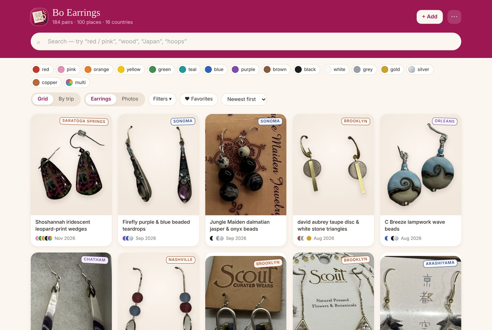
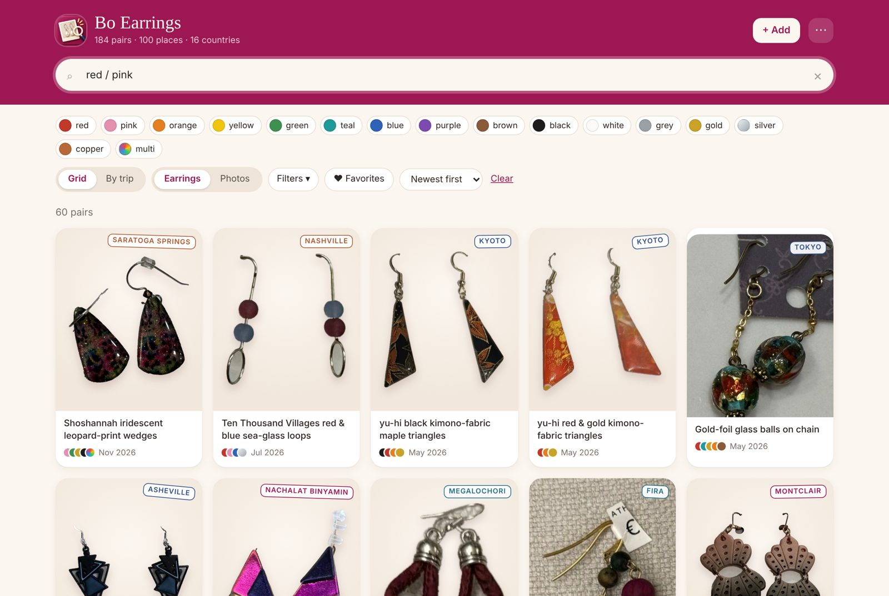
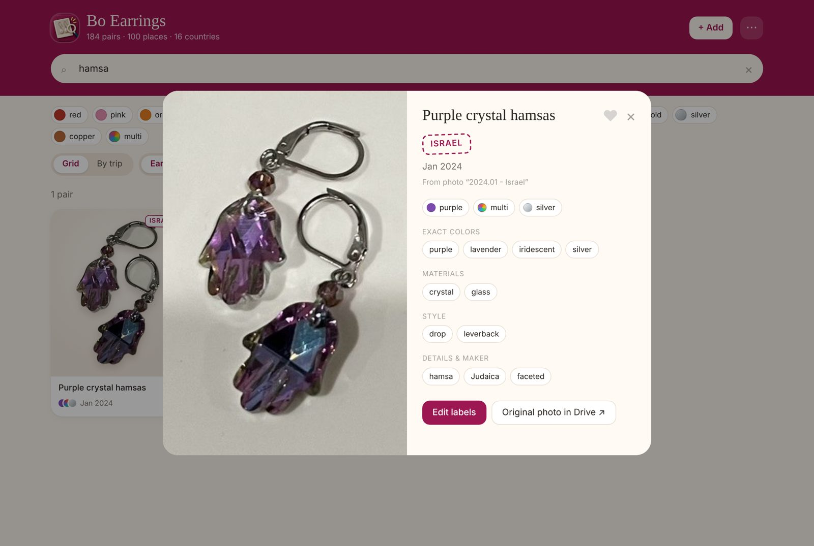
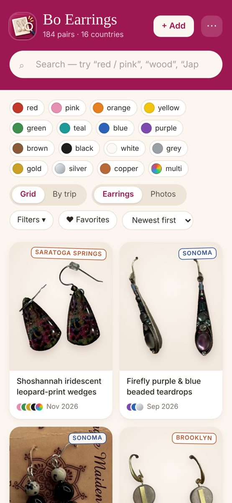

# Bo Earrings 💎

**A searchable catalog of every pair of earrings I've picked up while traveling, built from ten years of phone photos.**

For years I've bought a pair of earrings on every trip, photographed them, and filed the photo in Google Drive under the trip name. That made them easy to file and impossible to find: to look up a pair, I had to remember where I bought it. Bo Earrings turns that folder into an index I can search by what the earrings *look like*, like "red / pink", "wood", "hoops", "teardrop", or by where and when I got them.

**Live:** [taleesita.github.io/bo-earrings](https://taleesita.github.io/bo-earrings/) (sign-in restricted to two Google accounts)



## Features

- **Search the way you'd describe a pair.** Free-text search across colors, materials, shapes, makers, places and dates. `red / pink` means either and `blue wood` means both. Color searches use color families, so "red" also finds burgundy, maroon and wine.
- **Color swatches and filters.** 16 color families plus filters for material group (metal, stone, glass, clay…), style (drop, hoop, threader, statement…) and country or state.
- **Earrings that swing.** About 100 pairs are cut out of their photos, and each earring sways from its own hook when you hover, or as it scrolls into view on a phone. The rest show the original photo.
- **Passport stamps.** Each place gets a tilted ink stamp, and the *By trip* view reads like passport pages.
- **Details for every pair.** Exact colors, materials, style, maker or shop, the original trip photo, and a link back to it in Drive. Tap any label to search for it.
- **Edit and add.** Fix labels, favorite pairs, hide duplicates, and add new pairs with a photo. Edits sync between two users in real time.
- **Works like an app.** Installable PWA with offline caching, and laid out for phones first.

| Search: "red / pink" | Pair details | Phone |
|---|---|---|
|  |  |  |

## How the catalog was built

The starting point was **70 unlabeled photos and PDFs** (JPEG, HEIC, multi-page PDF), many showing several pairs on one card or tray. Turning that into **184 individually cropped and labeled pairs** was a one-time pipeline:

1. **Normalize.** HEIC and PDF pages were converted to oriented JPEGs (Pillow, pillow-heif, poppler).
2. **Find each pair.** Every photo was reviewed against a percentage grid overlay to place a bounding box around each pair, then cropped from the full-resolution source.
3. **Label.** Each pair got a title, exact colors, materials, style, motifs and maker. The maker came from shop cards, sticky notes and handwritten labels in the photos (e.g. *Rhombus*, *Glass by Romi*, *Crono Jewels*). Trip, place and date came from the file names.
4. **Cut out.** Background removal (rembg / ISNet), followed by a refinement pass. It estimates the local background color in Lab space, adds back thin hooks and pale parts the model drops, fills holes, removes specks, and splits pairs into left and right earrings with a hook pivot point for the swing animation. Every cutout was reviewed by eye, and any with flaws fall back to the photo.
5. **Verify.** Contact sheets of every crop and cutout were checked against the source photos.

This was built in collaboration with Claude (Anthropic), which did the photo review, labeling and code under my direction.

## Architecture

```
index.html          Single-file React 18 app (UMD + Babel standalone + Tailwind CDN), no build step
earrings.json       Seed catalog: 184 pairs with labels, source photo and cutout geometry
img/                Cropped photo of each pair (JPEG, 720px)
cut/                Transparent cutouts (WebP), split into left/right halves where possible
sw.js               Service worker: cache-first for images and CDN, network-first for app and data
```

- **Hosting:** GitHub Pages, deployed from a self-contained `deploy.html`. It embeds every file and pushes through the GitHub Git Data API (blobs, tree, commit, ref). It only uploads files whose git blob SHA changed, and it backs off and resumes when GitHub rate-limits.
- **Auth and data:** Firebase Auth (Google sign-in) plus Realtime Database. The seed catalog ships as static JSON. User changes are stored as a thin overlay on top of it: `overrides/`, `added/` (with compressed photos), `favorites/` and `hidden/`.
- **Security:** Database rules allow reads and writes only for two specific signed-in Google accounts. The Firebase web config in `index.html` is public by design; the database rules are what protect the data.

## Running locally

```bash
python3 -m http.server 8000
# open http://localhost:8000
```

Without Firebase config the app runs in **local mode**, with no sign-in and edits saved to `localStorage`.

## Roadmap

- Auto-label new uploads (colors, materials, style) from the photo
- Auto-detect and crop several pairs in one new photo
- "Wear today": a random pick, optionally matched to an outfit color

---

*Part of a small family of personal apps (activity tracker, expense tracker, travel map) built with the same single-file, GitHub Pages and Firebase pattern.*
